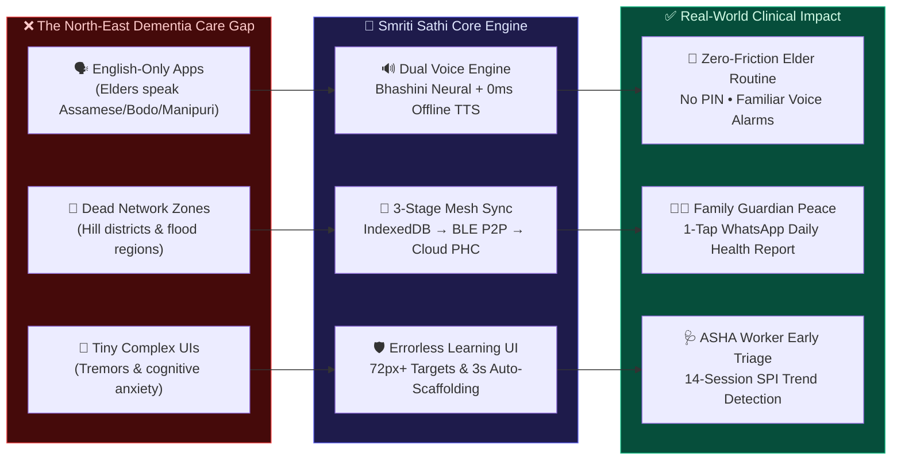
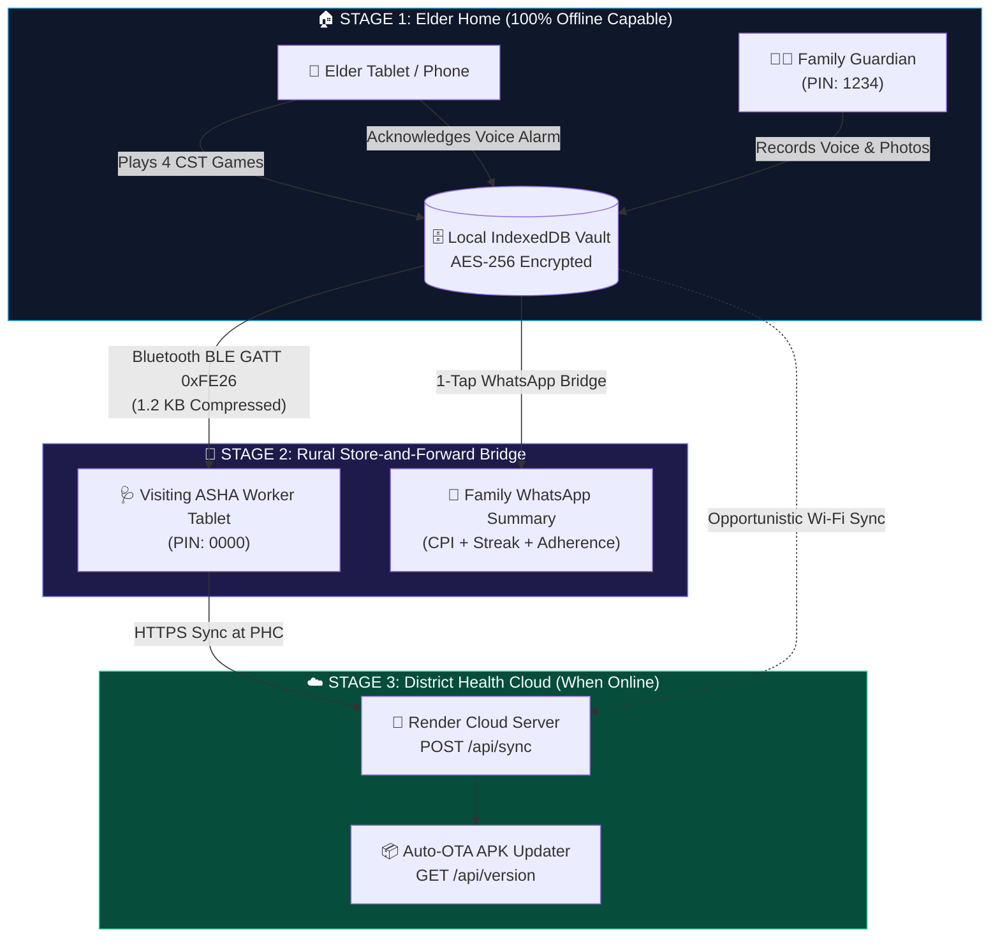
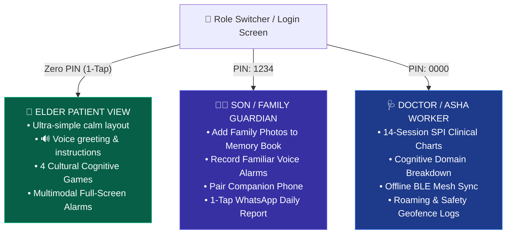
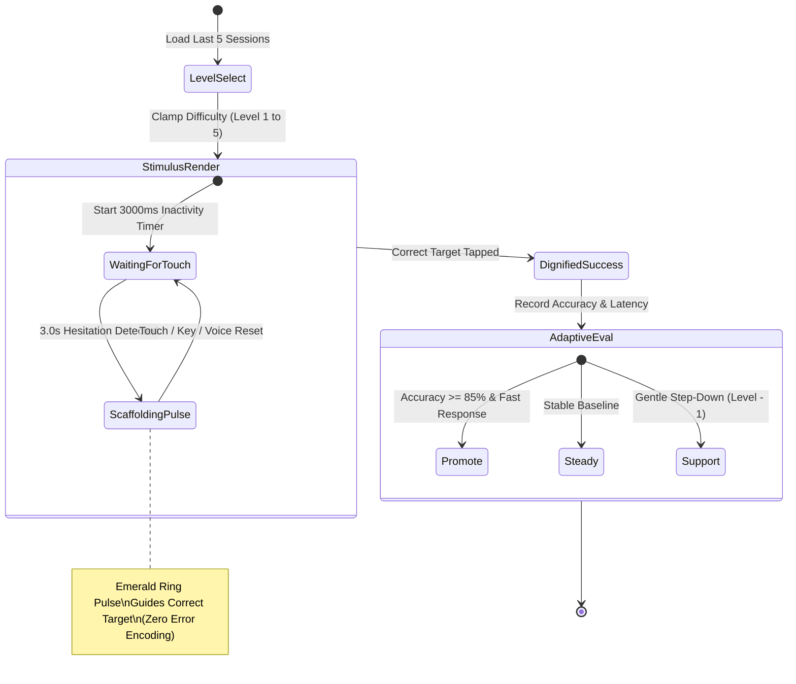
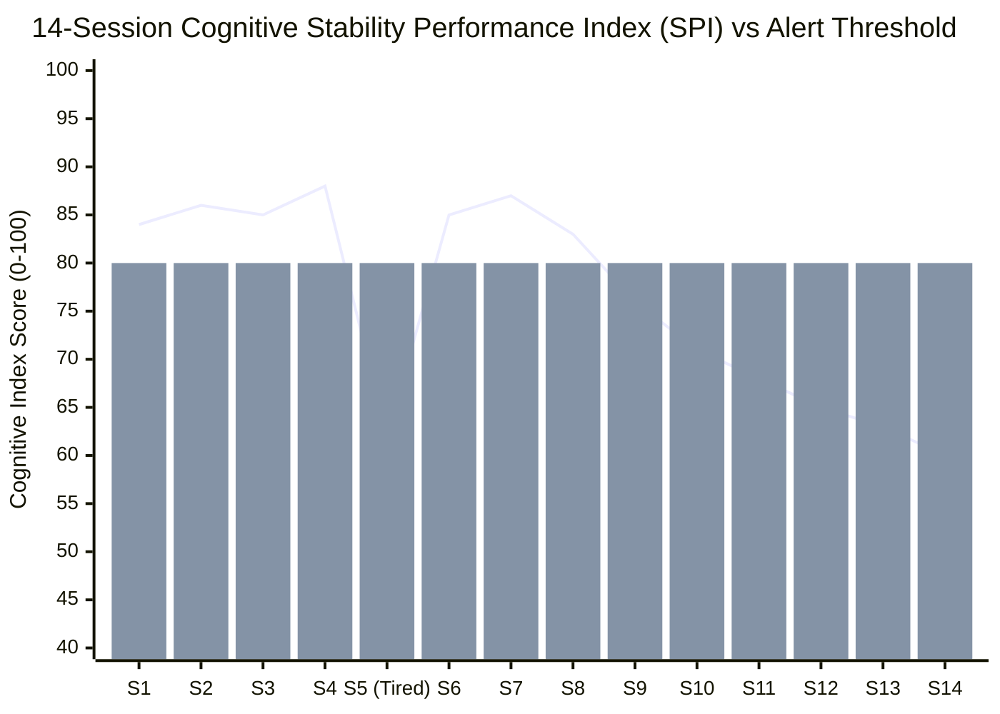
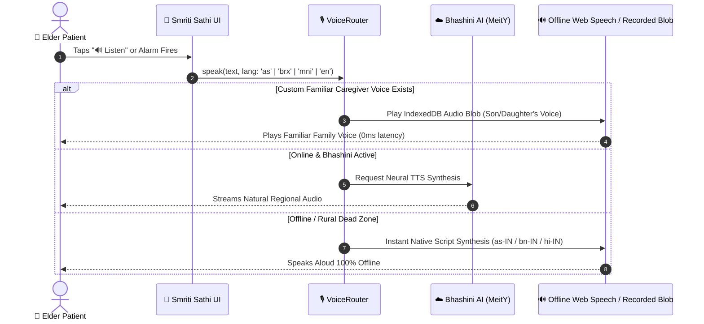
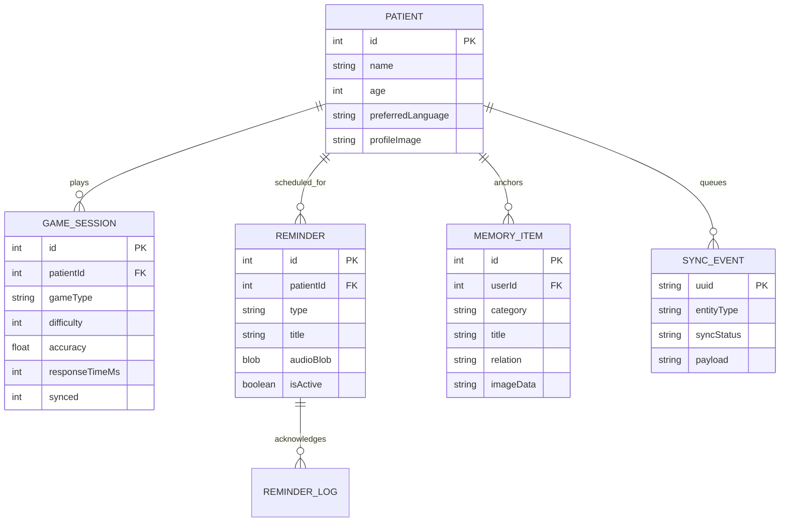

<div align="center">

# 🌸 Smriti Sathi (স্মৃতি সাথী • स्मृति साथी)

### **Offline-First Multilingual Cognitive Care & Dementia Companion for North East India**

[](https://github.com/yoursexybhavya/smriti-sathi/releases/download/v2.9.1/SmritiSathi-v2.9.1.apk)
[](https://smriti-sathi.onrender.com)

[](https://bhashini.gov.in/)
[-22C55E?style=flat-square)](#%EF%B8%8F-automated-verification--test-scoreboard)
[](#-scandinavian-senior-accessibility-specs)
[](#-local-first-database-er-diagram)
[](https://opensource.org/licenses/MIT)

[**📲 1-Tap APK**](https://github.com/yoursexybhavya/smriti-sathi/releases/download/v2.9.1/SmritiSathi-v2.9.1.apk) • [**🌐 Web Sandbox**](https://smriti-sathi.onrender.com) • [**🗺️ System Graph**](#-1-end-to-end-system--mesh-sync-architecture) • [**🧠 Cognitive Engine**](#-3-errorless-learning--adaptive-difficulty-state-machine) • [**📈 Clinical SPI Chart**](#-4-clinical-stability-performance-index-spi-trajectory)

</div>

---

## ⚡ What We Do — In One Visual Glance



---

## 📲 Instant Access (Phone, Tablet, or Browser)

| Channel | Action Link | What You Get |
| :--- | :--- | :--- |
| **🤖 Android APK** | [**Download `SmritiSathi-v2.9.1.apk`**](https://github.com/yoursexybhavya/smriti-sathi/releases/download/v2.9.1/SmritiSathi-v2.9.1.apk) | Native offline Android build with Auto-OTA Updater & Haptic Alarms |
| **🌐 Live Web App** | [**Launch `smriti-sathi.onrender.com`**](https://smriti-sathi.onrender.com) | Zero-install tablet/mobile browser experience |
| **🔑 Demo PINs** | **Elder:** `No PIN` • **Son/Guardian:** `1234` • **Doctor/ASHA:** `0000` | Instant role-switching via top header `Role ▾` button |

---

## 🗺️ 1. End-to-End System & Mesh Sync Architecture

How data flows from a zero-internet village home in Assam to the family guardian and Primary Health Centre (PHC):



---

## 👥 2. Three-Role Persona Ecosystem

One unified app that dynamically adapts its interface complexity to the person holding the device:



---

## 🧠 3. Errorless Learning & Adaptive Difficulty State Machine

Dementia patients get distressed by red "X" marks or "Game Over" screens. Smriti Sathi uses clinical **Errorless Learning**—distractors are gently disabled and a glowing emerald scaffold guides the elder after 3 seconds of hesitation:



### 🎮 The 4 Cultural Cognitive Stimulation Games

| Game | Clinical Domain | Level 1 &rarr; Level 5 Progression | North-East Cultural Anchors |
| :--- | :--- | :--- | :--- |
| **🎴 Remember & Recall** | Working Memory | `2 items (8s)` &rarr; `6 items (4s)` | Japi, Gamusa, Bell, Brass Cup |
| **🔍 Recognise Objects** | Visual & Spatial | `2 distinct items` &rarr; `6 subtle pairs` | Tea Cup, Spectacles, Prayer Lamp |
| **🌅 Daily Routine** | Temporal Sequencing | `2 morning steps` &rarr; `6 full-day steps` | Wake Up &rarr; Tea &rarr; Bath &rarr; Medicine |
| **🧩 Memory Match** | Episodic Recall | `2 pairs (4 cards)` &rarr; `6 pairs (12 cards)` | Errorless guided 2nd-card flip |

---

## 📈 4. Clinical Stability Performance Index (SPI) Trajectory

Unlike naive apps that panic on a single tired day, our **SPI Engine** evaluates a 14-session rolling median against the elder's personal baseline—filtering out single-session noise while catching real 7-session longitudinal drops:



> **Legend:** `Line` = Elder Session Score • `Bar (80)` = Personal Baseline Median  
> - **Session 5 (`Score: 62`):** Single bad day &rarr; **Ignored as normal variance** (No false alarm).  
> - **Sessions 8–14 (`83 → 60`):** Sustained 7-session drop + missed medicine &rarr; **Triggers non-diagnostic ASHA Check-In**.

---

## 🔊 5. Dual-Engine Regional Voice Pipeline



### 🌐 Supported Regional Languages

| Language | Native Script | Target Region | Offline Voice Fallback |
| :--- | :--- | :--- | :--- |
| **Assamese** | `অসমীয়া` | Brahmaputra Valley, Assam | `as-IN` &rarr; `bn-IN` &rarr; `hi-IN` |
| **Bodo** | `बर’ / Bodo` | Bodoland Territorial Region (BTR) | `brx-IN` &rarr; `hi-IN` |
| **Manipuri** | `মৈতৈলোন্` | Imphal Valley, Manipur | `mni-IN` &rarr; `bn-IN` |
| **English** | `English (India)` | Pan-NER & Clinical Dashboards | `en-IN` |

---

## 🗄️ 6. Local-First Database ER Diagram



---

## 🛡️ Scandinavian Senior Accessibility Specs

```text
┌────────────────────────────────────────────────────────────────────────────┐
│  🎨 CONTRAST & PALETTE         👆 TOUCH TARGETS        🧘 COGNITIVE SAFETY │
│  ─────────────────────         ────────────────        ─────────────────── │
│  • Daylight: #F8FAFC           • Primary CTA: 64px     • 0 Red Error States│
│  • Midnight: #0B0F19           • Game Tiles:  72px+    • 3s Auto-Scaffold  │
│  • WCAG AAA: >= 7.5:1          • Header Icons: 48px    • Native Body Scroll│
│  • Zero Glass Blur Traps       • Bottom Clearance:176px• Zero Punitive Text│
└────────────────────────────────────────────────────────────────────────────┘
```

---

## 🧪 Automated Verification & Test Scoreboard

Every build is verified against **285 automated E2E & adversarial tests** (`npm test`) in `< 1.0s`:

| Test Suite | Coverage Focus | Status | Pass Rate |
| :--- | :--- | :---: | :--- |
| **Tier 1: Feature Coverage** | 16 Core Features &times; 6 assertions | ✅ PASS | `██████████ 96/96 (100%)` |
| **Tier 2: Boundary & Corner Cases** | Touch sizing, overflow, null guards | ✅ PASS | `██████████ 96/96 (100%)` |
| **Tier 3: Cross-Feature Pairwise** | Role switch + Language + Offline sync | ✅ PASS | `██████████ 16/16 (100%)` |
| **Tier 4: Clinical Workflows** | 8 End-to-End Elder & ASHA journeys | ✅ PASS | `██████████ 8/8   (100%)` |
| **Tier 5A: Errorless Shield** | 10,000-click fuzzing & 3000ms timer | ✅ PASS | `██████████ 31/31 (100%)` |
| **Tier 5B: Voice & Modal Stress** | 25MB Audio Blobs, Portal & Haptics | ✅ PASS | `██████████ 35/35 (100%)` |
| **Clinical SPI Engine Baseline** | 14-Session Median & Alert Triage | ✅ PASS | `██████████ 3/3   (100%)` |
| **TOTAL** | **7 Verification Suites** | **🎉 100%** | **`285 / 285 TESTS PASSING`** |

---

## 🚀 3-Command Developer Quick Start

```bash
# 1. Install dependencies & run 285 E2E verification tests
cd smriti-sathi && npm install && npm test

# 2. Launch local development server
npm run dev

# 3. Compile production web bundle + Native Android APK
./build-apk.sh
```

---

<div align="center">

**Built with ❤️ for Elderly Cognitive Care in North East India**  
[📥 Download Android APK (`v2.9.1`)](https://github.com/yoursexybhavya/smriti-sathi/releases/download/v2.9.1/SmritiSathi-v2.9.1.apk) • [🌐 Open Web App](https://smriti-sathi.onrender.com)

</div>
