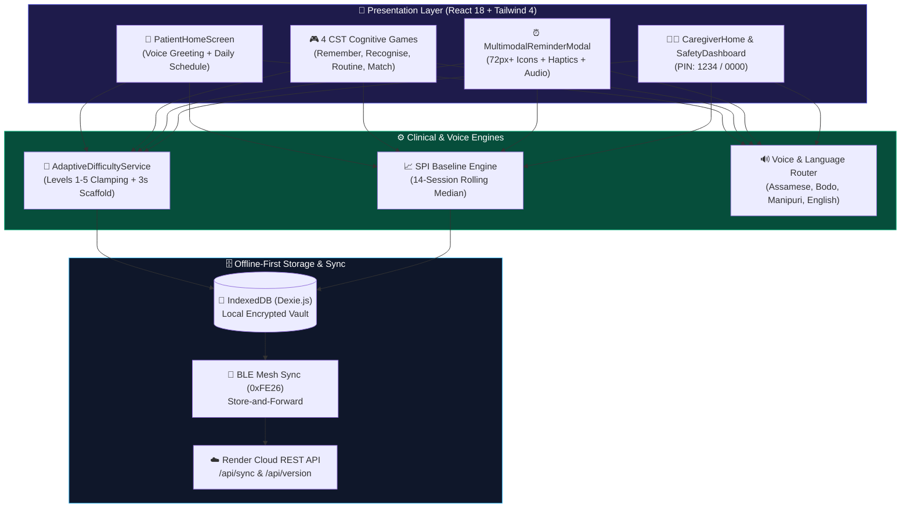
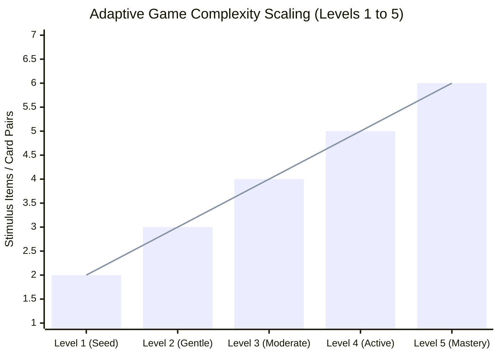
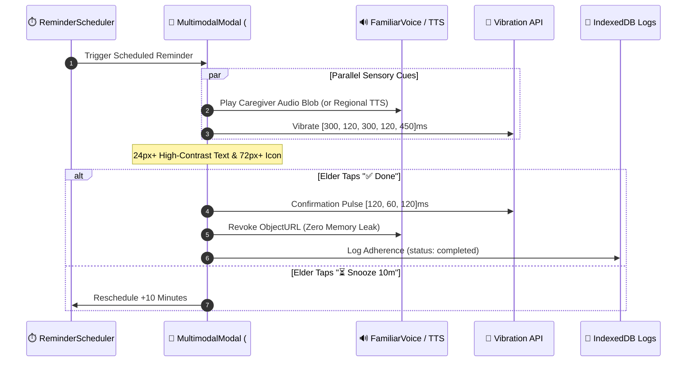

<div align="center">

# 🌸 Smriti Sathi — Technical & Clinical Architecture (`v2.9.1`)

[](https://github.com/yoursexybhavya/smriti-sathi/releases/download/v2.9.1/SmritiSathi-v2.9.1.apk)
[](https://smriti-sathi.onrender.com)

> **📥 [Download Smriti Sathi Android APK (`SmritiSathi-v2.9.1.apk`)](https://github.com/yoursexybhavya/smriti-sathi/releases/download/v2.9.1/SmritiSathi-v2.9.1.apk)**  
> **🌐 [Try Directly in Browser (No Installation Required): https://smriti-sathi.onrender.com](https://smriti-sathi.onrender.com)**

</div>

---

## 🏗️ 1. Component & Data Flow Graph



---

## 📊 2. Cognitive Game Progression & Errorless Scaffolding



| Level | Target Items | Preview Window | Errorless Safeguard |
| :---: | :---: | :---: | :--- |
| **Level 1** | `2 Items / Pairs` | `8.0s` | Distractors disabled + 3.0s emerald hint pulse |
| **Level 2** | `3 Items / Pairs` | `7.0s` | Distractors disabled + 3.0s emerald hint pulse |
| **Level 3** | `4 Items / Pairs` | `6.0s` | Guided pair matching + positive reinforcement |
| **Level 4** | `5 Items / Pairs` | `5.0s` | Cultural artifact discrimination |
| **Level 5** | `6 Items / Pairs` | `4.0s` | Full circadian routine & matrix recall |

---

## 🔄 3. Multimodal Reminder Lifecycle



---

## 📁 4. Visual Repository Map

```text
smriti-sathi/
├── 🤖 android/                    # Native Capacitor Android project (versionCode 291)
├── ☁️ server/                     # Express Cloud Sync & Auto-OTA Version Server
├── 🧪 tests/                      # 7 Automated Test Suites (285/285 Passing)
├── 🎨 src/
│   ├── components/                # Accessible UI (AppHeader, BottomNav, FamilyPairingModal)
│   ├── context/ & contexts/       # Auth, App, Patient, & Multilingual State
│   ├── database/ & db/            # Offline-First IndexedDB Repositories
│   ├── engine/                    # Clinical SPI 14-Session Baseline Engine
│   ├── hooks/                     # useVoice, useInactivityScaffolding, useReminderScheduler
│   ├── pages/
│   │   ├── PatientHomeScreen.tsx  # Simplified Elder Companion Dashboard
│   │   ├── GamesScreen.tsx        # 4 Cultural Cognitive Workouts
│   │   ├── caregiver/             # CaregiverHome & SafetyDashboard
│   │   └── onboarding/            # 4-Step Guided Caregiver Setup
│   └── services/                  # AdaptiveEngine, Bhashini/TTS, Sync, & Safety
└── 🛠️ build-apk.sh                # 1-Click Vite → Capacitor → Gradle APK Builder
```

---

## ⚡ Commands & Verification

| Command | Action | Expected Output |
| :--- | :--- | :--- |
| `npm test` | Runs all 7 E2E & Adversarial test suites | `285 / 285 Passing (100%)` in `< 1s` |
| `npm run typecheck` | Strict TypeScript compiler verification | `0 Errors` |
| `npm run build` | Production Vite asset bundle | Built in `~850ms` |
| `./build-apk.sh` | Compiles `SmritiSathi-v2.9.1.apk` | Copies APK to root & Desktop |
