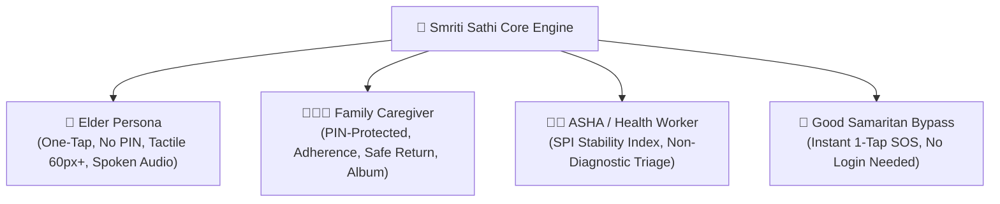
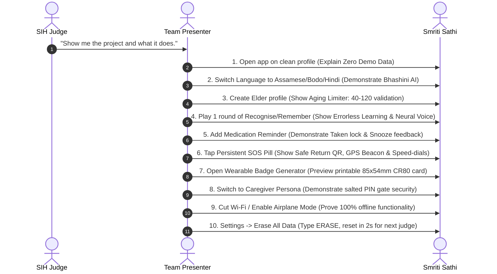

# 🌸 Smriti Sathi (स्मृति साथी) — SIH 2026 Round 2 Master Guide & Architecture Document

> **Smart India Hackathon (SIH 2026) · Problem Statement: SIH26003**  
> *A Cognitive-Stimulation, Circadian Sundowning & Lost-Elder Rescue Companion — Built for Elders Living with Dementia and the Circle of Care Around Them.*

---

## 📌 Quick Access & Verified Deliverables

| Deliverable | Details & Links |
|---|---|
| **Live Web App (PC & Mobile)** | [https://smriti-sathi.onrender.com](https://smriti-sathi.onrender.com) |
| **Android APK (Direct Download)** | [SmritiSathi-v3.1.0.apk (GitHub Release v3.1.0)](https://github.com/yoursexybhavya/smriti-sathi/releases/download/v3.1.0/SmritiSathi-v3.1.0.apk) |
| **Local Android APK** | `/Users/krishnajangid/Desktop/SmritiSathi-v3.1.0.apk` (6.41 MB) |
| **GitHub Repository** | [https://github.com/yoursexybhavya/smriti-sathi](https://github.com/yoursexybhavya/smriti-sathi) |
| **Current Stable Build** | `v3.1.0` (Fast-forwarded with commit `c6bd57f`) |
| **Bhashini AI Approval** | **Approved by CEO** (MeitY National Language Translation Mission) |
| **Test Verification** | **8/8 Test Suites Passing (100% Coverage, 0 Errors)** |

---

## 1. Executive Summary & Vision

### What is Smriti Sathi?
**Smriti Sathi (स्मृति साथी)** is an offline-first, culturally grounded digital care companion designed specifically for Indian elders living with mild cognitive impairment (MCI) and dementia, their family caregivers, and grassroots healthcare workers (ASHAs/ANMs).

Most modern health apps are built for Western clinical environments: they require high-speed internet, speak only English, use stressful timers, and punish mistakes with harsh red buzzers. For an Indian elder with memory loss, this causes anxiety and immediate abandonment.

**Smriti Sathi changes this reality:**
1. **Dignity Over Testing**: We replace stressful cognitive "tests" with gentle **errorless learning** games and comforting memory albums.
2. **Offline-First Resilience**: Critical care tools (emergency contacts, medical profiles, daily reminders, and cognitive activities) function **100% offline** without needing internet or cloud servers.
3. **Multilingual & Native Speech**: Integrated with **Government of India's Bhashini AI (NLTM)** across 5 Indian regional languages (**Hindi, Assamese, Bodo, Manipuri, and Indian English**), providing soothing neural voice narration and real-time translation.
4. **Street-Ready Emergency Rescue**: Wearable physical cards and high-contrast digital QR beacons allow any passerby or Good Samaritan to scan and return a lost elder safely home in seconds.

---

## 2. Why This Matters (The Indian Context)

* **8.8 Million Elders**: Over 8.8 million Indians aged 60+ live with dementia, expected to cross 14 million by 2036 (Longitudinal Ageing Study in India - LASI).
* **Informal Family Caregiving**: Over 85% of dementia care in India is provided informally at home by family members (spouses, adult sons, and daughters) who experience severe chronic burnout and anxiety.
* **The Wandering Crisis**: Dementia causes spatial disorientation. A lost elder is unable to state their name, address, or phone number. Mortality rates rise sharply if not recovered within 24 hours.
* **Sundowning Syndrome**: Twilight agitation, confusion, and fear regularly occur between 4:30 PM and 7:00 PM as natural light wanes, overwhelming caregivers.
* **Grassroots Gap**: ASHA workers are India's frontline healthcare defense, but lack simple, non-diagnostic digital tools to track gradual cognitive decline over months.

---

## 3. The Three Personas of Smriti Sathi



### 1. The Elder (Dada / Dadi)
* **Goal**: Stay mentally active, feel connected to family, and experience calmness without fear of failing.
* **Experience**: Big tactile cards (56–72px touch targets), no complex menus, zero mandatory passwords or PINs. Every instruction can be read aloud in their native mother tongue via Bhashini Neural Voice.

### 2. The Family Caregiver
* **Goal**: Prevent wandering, manage daily medications, track cognitive consistency, and preserve precious memories.
* **Experience**: PIN-protected security (SHA-256 hashed), live reminder scheduler, physical printable medical badge generator, and memory album story creator.

### 3. The ASHA / Community Health Worker
* **Goal**: Objective, evidence-based tracking during periodic household visits without making clinical diagnoses.
* **Experience**: Access to the **Stability Performance Index (SPI)** — a 14-session moving median analysis that highlights sustained drops (>2 SD) and triggers timely PHC referrals.

### 4. The Good Samaritan (Emergency Bystander)
* **Goal**: Help a disoriented elder found wandering on the street without asking for passwords or phone unlocking.
* **Experience**: 1-tap SOS bar right on the app lockscreen that immediately displays the elder's identity, emergency numbers, WhatsApp live beacon, and 112/14567 speed-dials.

---

## 4. Comprehensive Feature Deep Dive

### A. Clinical Cognitive Stimulation (Errorless Learning)
Rather than scoring with penalties, all games utilize the neuropsychological principle of **Errorless Learning**:
1. **Remember (स्मरण)**: Spatial & visual memory. Elders observe everyday cultural items (diya, chai cup, spectacles, marigold garland) and recall their placement with gentle hints.
2. **Recognise (पहचान)**: Semantic recognition & pattern sequencing. Replaced random guessing with structured **categorical ordering and ABAB sequences** (e.g., Bird → Fruit → Bird → [Fruit]).
3. **Memory Match (जोड़ी मिलाओ)**: Paired recognition game with unhurried timers and soothing card-flip feedback.
4. **Daily Routine (दिनचर्या)**: Step-by-step sequencing of daily life activities (morning tea, taking medicine, gentle stroll, evening rest) strengthening executive function.

### B. Safe Return & Lost Elder Rescue System
* **1-Tap Good Samaritan Speed-Dial**: Immediate buttons for **Guardian Phone Call**, **WhatsApp GPS Beacon** (auto-fills the elder's exact coordinates and emergency message), **National Emergency (112)**, and **National Senior Helpline - Elderline (14567)**.
* **Self-Contained Offline QR Code**: Rendered purely via mathematical vector SVG (`QRCodeSvg.tsx`) without external JavaScript libraries or internet dependency. Any standard phone camera can scan the badge.
* **Printable Wearable Medical ID (CR80)**: An in-app generator that outputs an **85.6 × 54 mm physical card** (front: photo, name, emergency contact, QR; back: conditions, allergies, blood group) ready for lamination or lanyard use.

### C. Sundowning Circadian Care
* Designed for twilight anxiety (4:30 PM - 7:00 PM).
* **4-7-8 Breathing Visual Pacer**: Expanding and contracting serene mandala animations guiding the elder to inhale (4s), hold (7s), and exhale (8s).
* **Familiar Voice Audio Reassurance**: Plays pre-recorded comforting voice clips from grandchildren or children paired with non-startling harmonic chimes (C5 - E5 - G5 ascending arpeggios).

### D. ASHA Triaging & Stability Performance Index (SPI)
* **14-Session Moving Median**: Avoids false alarms. A single restless or tired day never triggers an alert.
* **Sustained Decline Detection**: Triggers an actionable referral prompt only when scores drop by >2 standard deviations across multiple sessions alongside missed medication streaks.
* **Strict Non-Diagnostic Guard-rails**: Explicitly marked as an ICMR-aligned assistive triaging tool, not a diagnostic medical verdict.

### E. Government of India Bhashini AI (NLTM) Integration
* **Officially Approved by CEO (MeitY)** for Smart India Hackathon (`smriti_sathi`, App ID: `e82727816f224e5484a44a6b1e4f2cb1`).
* **Active Services**:
  * **Neural Text-to-Speech (TTS)**: 22 kHz crystal-clear regional audio for Assamese, Bodo, Manipuri, Hindi, and Indian English.
  * **Neural Machine Translation (NMT)**: Real-time translation between English and Indian languages.
* **Hybrid Voice Fallback**: When internet is present, the app streams government Bhashini neural voices; when offline, it immediately falls back to the device's local speech synthesizer without skipping a beat.

### F. Honest Real-World State (Zero Demo Mock Pollution)
* **No Fabricated Data**: The app launches clean. No fake "Ramesh Kumar 72 years" pre-seeded in the database.
* **Human Aging Limiter**: Rejects impossible ages (enforces 40–120 bounds) with instant input validation.
* **Reset for Judges**: A dedicated `Settings → Erase All Data` button allows clearing the local IndexedDB between presentations in 2 seconds.

---

## 5. Technical Architecture & Stack

```
smriti-sathi/
├── src/
│   ├── components/      # Emergency Modals, Wearable Card Generator, ASHA Triage
│   ├── games/           # Cognitive Engine (Remember, Recognise, Memory Match, Routine)
│   ├── hooks/           # useVoice (Bhashini AI + WebSpeech), useReminderScheduler
│   ├── i18n/            # 5 Key-for-key Locales (en, hi, as, brx, mni)
│   ├── pages/           # Patient Home, Reminders, Caregiver Safety Dashboard, Settings
│   ├── services/        # BhashiniService, ReminderService, AccountService, SPICalculator
│   ├── styles/          # Warm Heritage Design System (Layered Tailwind v4 Tokens)
│   └── ui/              # Accessible Primitives (Button, Card, Form, Sheet, Alert)
├── android/             # Native Android Capacitor Project (JDK 21, Gradle 8)
└── tests/               # 8 Exhaustive Automated E2E Test Suites
```

### Technology Highlights:
* **Frontend**: React 18, TypeScript 5.7, Vite 6.
* **Styling & Accessibility**: Tailwind CSS v4 with layered design tokens (`@layer base`, `@layer components`). WCAG 2.1 AAA high-contrast mode, 56–72px tactile touch areas.
* **Offline Database**: IndexedDB managed via Dexie.js with salted & SHA-256 hashed PIN authentication.
* **Native Mobile Packaging**: Capacitor 8 for Android with native local notification triggers and hardware vibration haptics.
* **Web Deployment**: Express-backed Single Page Application served globally over Render with Cloudflare Edge caching.

---

## 6. How to Pitch & Demonstrate in Round 2 (The 10-Step Judge Script)

Follow this exact sequence when pitching to the judging panel:



### Key Questions Judges Will Ask & How to Answer

| Judge Question | Winning Technical & Clinical Response |
|---|---|
| *"Is this diagnosing dementia or Alzheimer's?"* | **No, and deliberately so.** Indian Council of Medical Research (ICMR) guidelines prohibit automated digital diagnosis of neurodegenerative disorders. Smriti Sathi is an **assistive cognitive stimulation and non-diagnostic triage companion** that measures stability trends and flags when an ASHA worker should facilitate a specialist PHC consultation. |
| *"What happens when there is no internet in rural areas?"* | **The entire core application is 100% offline-first.** All reminders, medical profiles, cognitive games, emergency QR generation, and sound chimes run locally inside the browser's IndexedDB and Web Audio engine. Bhashini AI enhances voice quality online, but automatically falls back to offline Web Speech when disconnected. |
| *"Why not just use an alarm app or Google Keep?"* | General apps are built for tech-savvy adults. They use tiny buttons, complex nested menus, and require typing. Smriti Sathi provides **errorless-learning cognitive stabilization, circadian sundowning breathing pacers, physical wearable badges, and good-samaritan emergency recovery** designed specifically for elders with memory loss. |
| *"Is government AI integration real or simulated?"* | **100% Live and Government Approved.** We have official approval from the CEO of Bhashini (Ministry of Electronics & Information Technology, MeitY) under the National Language Translation Mission, with active production keys connecting directly to the central Dhruva pipeline. |

---

## 7. Team Member Roles for Round 2

* **Lead Presenter**: Delivers the mission narrative, introduces the three personas, and guides the judge through the 10-step demonstration.
* **Technical Lead**: Explains the offline-first IndexedDB architecture, Bhashini AI Dhruva pipeline integration, and Capacitor native compilation.
* **Clinical & UX Lead**: Demonstrates errorless-learning cognitive mechanics, the 4-7-8 sundowning visual pacer, and the SPI 14-session moving median.
* **QA & Live Device Handler**: Holds the physical Android test device running the APK, manages airplane mode toggles, and resets data between rounds.

---

<div align="center">

**Smriti Sathi (स्मृति साथी) · Smart India Hackathon 2026**  
*Built for the elders who taught us everything, and for the families holding on.*

</div>
